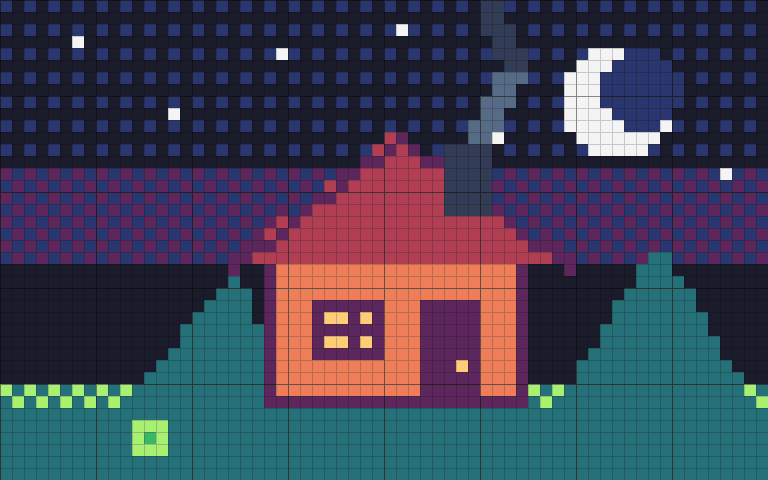
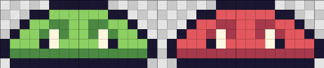
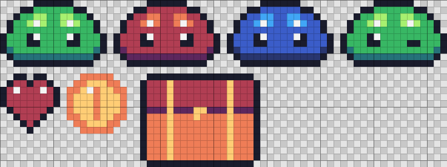

<div align="center">

# pxl-lite

**Draw game-ready pixel art as code: sprites, recolors and sprite sheets from one JavaScript file, no install.**

The sprite core of [claude-pxl](https://github.com/crsolver/claude-pxl) (481 stars in two weeks) as one plain-JavaScript file: no TypeScript sources and no Node 22.18 requirement.

Works with **Claude Code** and **Codex**.

 



<sub>Real output: <code>node pxl-lite.mjs build examples/cabin.px.js</code>, the 12x preview of one 64x40 sprite.</sub>

</div>

## Quick start
```bash
git clone https://github.com/Dodai0419/pxl-lite && cd pxl-lite
node pxl-lite.mjs build examples/slime.px.js --out out
```
```
sprite slime 16x7 @16x
sprite slime_red 16x7 @16x
sheet chars 33x7 (2 frames) @16x
```
`examples/slime.px.js` is claude-pxl's own README example, unchanged:

```js
pal({ k: "#1b1630", g: "#8ccf63", G: "#4c8a44", w: "#fff6e0", r: "#e2585e", R: "#a63a4c" })

// Write the left half; mirror it and outline it automatically.
sprite("slime", { mx: true, outline: "k" }, `
  ....ggg
  ..ggGGg
  .ggGwGg
  gggkwgg
  GGGGGGG`)
sprite("slime_red", { base: "slime", swap: { g: "r", G: "R" } })   // a recolor in one line

sheet("chars", ["slime*"], { pad: 1 })
```



Output, same layout as claude-pxl:
```
out/sprites/slime.png  out/sprites/slime_red.png   the art, at 1x
out/chars.png          out/chars.json              sprite sheet + TexturePacker-style JSON (Phaser, Godot importers)
out/_preview/*.png                                 upscaled previews with a pixel grid
```

## Gallery

**Characters, items and variants** (`examples/basics.px.js`): four slimes from one drawing (`base` + `swap`, a wink drawn over the base), a heart with a shared center column (`mx: "c"`), a coin from two circles, a chest from rects:



The 1x sheet an engine loads ([docs/basics-sheet-1x.png](docs/basics-sheet-1x.png), 67x25) and its frame map ([docs/basics-sheet.json](docs/basics-sheet.json)):

```json
"slime_blue": { "frame": { "x": 34, "y": 0, "w": 16, "h": 10 }, "rotated": false, "trimmed": false, ... }
```

**A scene in one sprite** (`examples/cabin.px.js`, top of this page): `dither` sky bands, `poly` roof and hills, a 2 px round-brush `line` for smoke, `fill` for a bush, and a function item for the stars.

**Exact pixels for agents.** `node pxl-lite.mjs ascii examples/slime.px.js slime` prints the sprite as palette keys, so an agent can check its work without looking at an image:
```
.....kkkkkk.....
...kkggggggkk...
..kggGGggGGggk..
.kggGwGggGwGggk.
kgggkwggggwkgggk
kGGGGGGGGGGGGGGk
.kkkkkkkkkkkkkk.
```

## The problem
- claude-pxl runs its TypeScript sources directly, which needs Node 22.18 or newer; older Node fails before drawing a pixel.
- Most sprite jobs (characters, items, icons, recolors, a sheet) use a small part of a 3,600-line engine.
- An agent that only needs sprites still loads the docs for layers, scenes, lighting and the live viewer.

## The solution
| Idea | Fixes |
|------|-------|
| **One plain `.mjs` file, 352 lines** | Copy it anywhere; no build step, no type stripping, no `npm install`. |
| **Same DSL, same results** | `pal`, `sprite`, `sheet`, the primitives and the variant options keep claude-pxl's names and rules; its own test cases pass unchanged. |
| **Clear edges** | Calling a feature that is not here (`anim`, `layer`, `stamp`, `lighting`, ...) stops with "not in pxl-lite; use crsolver/claude-pxl". |

## Use with Claude Code
```bash
/plugin marketplace add Dodai0419/pxl-lite
/plugin install pxl-lite@pxl-lite
```
Then: *"Draw a 16x16 knight with red, blue and gold variants and put them in one sprite sheet."*

## Use with Codex (ChatGPT)
```bash
git clone https://github.com/Dodai0419/pxl-lite && cp -r pxl-lite/skills/* ~/.codex/skills/
```
Or copy `AGENTS.md` into your project root.

## Benchmarks
| | claude-pxl | pxl-lite |
|-|-|-|
| upstream test cases for the sprite core (grid, mirror, outline, swap/flip/rot, overlay, 8 primitives, clip, function items, sheet globs) | pass (upstream's suite) | same 20 expected outputs pass in `test/` |
| lines of code | 3,592 (`src/core` + `src/node`) | 352 (one file) |
| Node required | >= 22.18 (`engines`) | written for >= 18, tested on 24.20 |
| runtime deps | 0 | 0 |
| load + build all 9 sprites of `examples/basics.px.js` | not measured | 20.5 ms (avg of 50) |
| full `build` incl. PNG files + previews, same file | not measured | 470 ms (avg of 10; 68 ms without previews) |

Windows 11, Node 24.20; timing loops call `load()` / `build()` in one process. Line counts: `wc -l`.
claude-pxl was not run here (its CLI could not be executed in this session), so its timings are not measured and the comparison is on its published test expectations.

## What it does not do
Animation and GIF export, layers and scenes, stamps, tiles and tilemaps, scatter brushes, ramps with `shade`/`light`, lighting and normals, the pixel font, and the live painting viewer. For those, use [claude-pxl](https://github.com/crsolver/claude-pxl).

## Inspired by
- [crsolver/claude-pxl](https://github.com/crsolver/claude-pxl): the DSL, palettes, rasterizers, sheet format, preview style and test cases (MIT, see `NOTICE`).

## Roadmap
- [ ] `anim` + GIF export (frames as patches over a base sprite)
- [ ] `stamp` and `tile` for reusable parts
- [ ] `--watch` rebuild on save

## License
MIT
